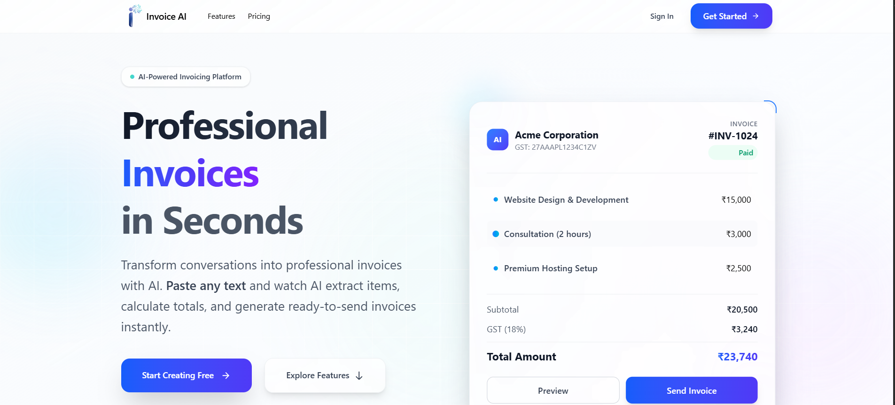
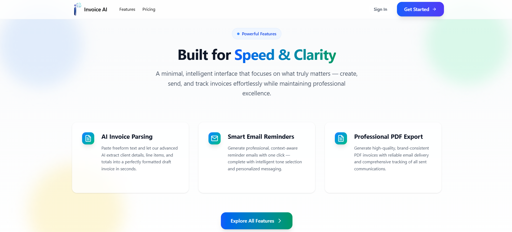
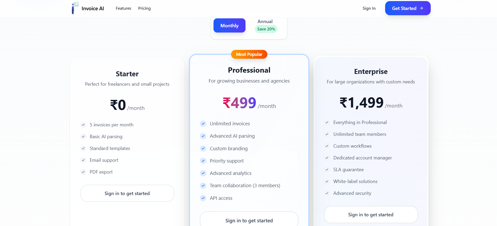
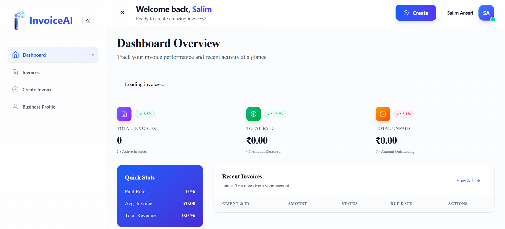
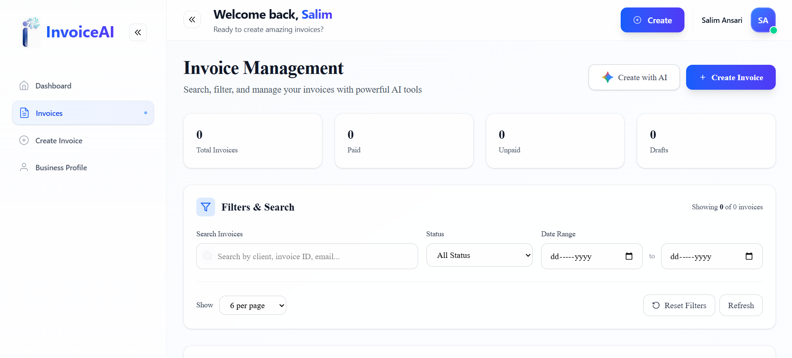
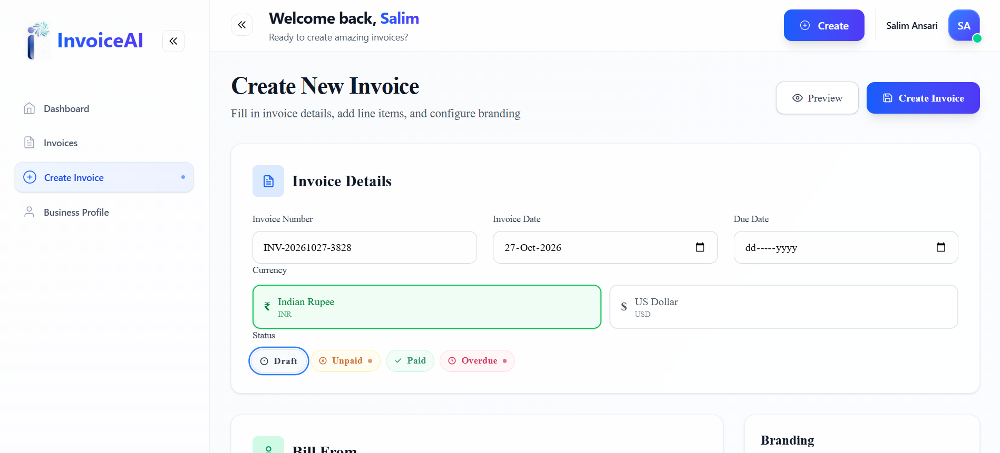
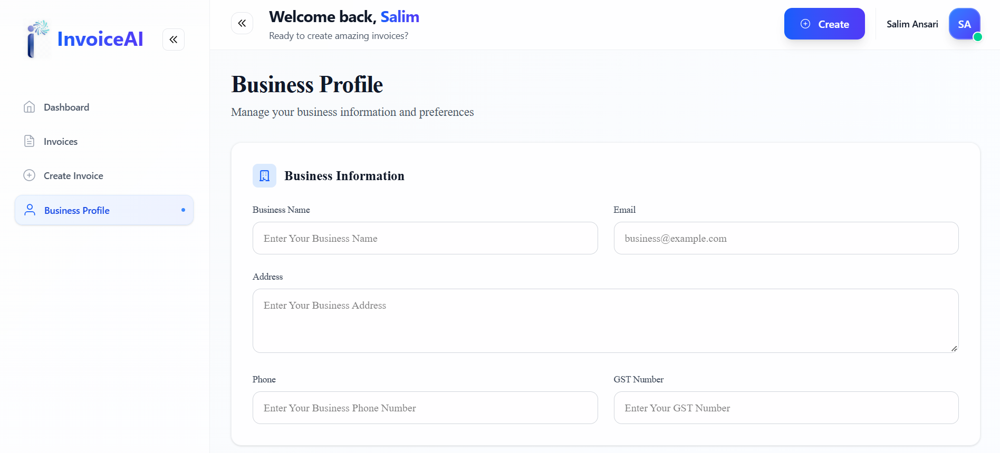
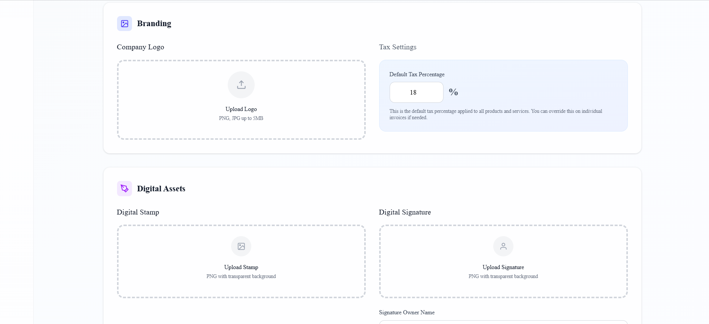
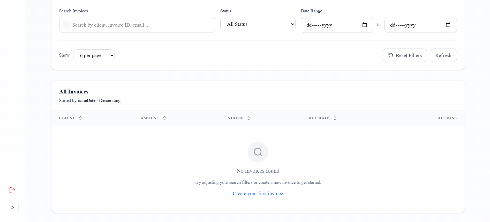

# InvoiceAI — AI-Powered Invoice Management Platform

<div align="center">

### Create professional invoices in seconds with AI.

InvoiceAI is a modern, full-stack invoicing platform designed to simplify billing, automate invoice creation, and help businesses manage their invoices through an intuitive dashboard.

[Features](#-features) · [Screenshots](#-screenshots) · [Tech Stack](#-tech-stack) · [Installation](#-installation-and-setup) · [API Structure](#-project-structure) · [Contributing](#-contributing)

</div>

---

## 📌 Overview

InvoiceAI helps freelancers, startups, and businesses create, organize, and manage professional invoices from one centralized platform.

The application combines a React-based frontend with an Express.js backend to provide an organized invoicing workflow, AI-assisted invoice creation, business profile management, tax calculations, and invoice tracking.

### Why InvoiceAI?

- **AI-assisted invoicing:** Generate structured invoice drafts from natural-language input using Google Gemini.
- **Invoice management:** Search, filter, and organize invoices by status and date.
- **Business profiles:** Maintain reusable business details for billing.
- **Flexible billing:** Support invoice line items, quantities, prices, taxes, and multiple currencies where implemented.
- **Professional branding:** Customize invoice branding with logos, digital stamps, and signatures where supported.
- **Modern dashboard:** Review invoice activity, payment status, and financial summaries.
- **Secure authentication:** Integrate Clerk authentication into the application.

## ✨ Features

### 🤖 AI-Powered Invoice Creation
- Convert descriptive text into structured invoice data.
- Extract client details, item descriptions, quantities, and prices where supported by the AI workflow.
- Review and edit generated invoice information before saving.
- Reduce repetitive invoice data entry.

### 📊 Dashboard
- View invoice statistics and financial summaries.
- Track paid, unpaid, overdue, and draft invoices.
- Review recent invoice activity.
- Access invoice creation and management tools.

### 🧾 Invoice Management
- Create and organize invoices.
- Search by client name, invoice number, or email where supported.
- Filter invoices by payment status.
- Filter records using a date range.
- Review invoice details and totals.
- Manage invoice status and due dates.

### 🏢 Business Profile
- Configure business name and email.
- Maintain business address and phone number.
- Store GST information.
- Reuse business details when preparing invoices.

### 🎨 Invoice Branding
- Configure company branding.
- Upload a company logo.
- Add digital stamps and signatures where implemented.
- Set signature owner and designation.
- Maintain a consistent appearance across invoices.

### 💰 Tax and Pricing
- Calculate item totals, subtotals, and tax amounts.
- Configure default tax percentages.
- Present pricing plans for different business needs.
- Support INR and USD where enabled.

### 🔐 Authentication
- Clerk integration for authentication.
- Protected application pages where configured.
- Authenticated API access where configured.

## 🖼️ Screenshots

The following screenshots represent the application's main interface. Place the corresponding image files in your repository's `screenshots/` directory.

### 1. Landing Page



### 2. Features Section



### 3. Pricing Plans



### 4. Dashboard Overview



### 5. Invoice Management



### 6. Create Invoice



### 7. Business Profile



### 8. Invoice Branding and Digital Assets



### 9. Invoice List and Filters



> **Important:** These image paths are examples based on your screenshots. Rename your actual image files to match the paths above, or update the Markdown paths to match the filenames already in your `screenshots/` folder. GitHub displays images only when the referenced files exist in the repository.

## 🛠️ Tech Stack

### Frontend

| Technology | Purpose |
|---|---|
| React 19 | Component-based user interface |
| Vite 7 | Development server and production build |
| React Router 7 | Client-side routing |
| Tailwind CSS 4 | Utility-first styling |
| Clerk React | Frontend authentication integration |
| JavaScript ES Modules | Application logic |
| Cypress | End-to-end testing framework |

### Backend

| Technology | Purpose |
|---|---|
| Node.js | JavaScript runtime |
| Express 5 | Backend API and routing |
| MongoDB | Database |
| Mongoose 9 | MongoDB object modeling |
| Google GenAI SDK | AI-assisted invoice generation |
| Clerk Express | Backend authentication integration |
| Multer | File upload handling |
| bcryptjs | Password hashing utilities, if used |
| JSON Web Token | Token handling, if used |
| Validator | Input validation |
| dotenv | Environment variable configuration |
| CORS | Cross-origin request configuration |

## 🏗️ Project Structure

The application is organized into separate frontend and backend directories.

```text
InvoiceAI/
│
├── Backend/
│   ├── config/
│   ├── controllers/
│   ├── models/
│   ├── routes/
│   ├── uploads/
│   ├── .gitignore
│   ├── package.json
│   ├── package-lock.json
│   └── server.js
│
├── Client/
│   ├── src/
│   │   ├── assets/
│   │   ├── components/
│   │   │   ├── AIInvoiceModal.jsx
│   │   │   ├── AppShell.jsx
│   │   │   ├── Features.jsx
│   │   │   ├── Footer.jsx
│   │   │   ├── GeminiIcon.jsx
│   │   │   ├── Hero.jsx
│   │   │   ├── InvoicePreview.jsx
│   │   │   ├── KpiCard.jsx
│   │   │   ├── Navbar.jsx
│   │   │   ├── Pricing.jsx
│   │   │   └── StatusBadge.jsx
│   │   │
│   │   ├── pages/
│   │   │   ├── BusinessProfile.jsx
│   │   │   ├── CreateInvoice.jsx
│   │   │   ├── Dashboard.jsx
│   │   │   ├── Home.jsx
│   │   │   ├── Invoices.jsx
│   │   │   └── NotFound.jsx
│   │   │
│   │   ├── .env
│   │   ├── App.css
│   │   ├── App.jsx
│   │   ├── index.css
│   │   └── main.jsx
│   │
│   ├── .env
│   ├── .gitignore
│   ├── eslint.config.js
│   ├── index.html
│   ├── package.json
│   ├── package-lock.json
│   └── vite.config.js
│
├── screenshots/
├── .gitignore
└── README.md
```

*This tree reflects the structure shown in the project explorer. Some directories may contain additional files.*

## ⚙️ Installation and Setup

### Prerequisites

Ensure you have the following installed:

- Node.js (a version compatible with your dependencies)
- npm
- MongoDB or a configured MongoDB connection
- A Clerk application with the required authentication keys
- A Google Gemini API key if AI functionality is enabled
- Git

### 1. Clone the Repository

```bash
git clone https://github.com/imsalimansari/Invoice_AI
cd InvoiceAI
```

Replace `YOUR_USERNAME` with your GitHub username and adjust the repository URL if necessary.

### 2. Set Up the Backend

Navigate to the backend directory:

```bash
cd Backend
npm install
```

Create a `.env` file in `Backend/` and configure the variables expected by your backend code.

Example template:

```env
PORT=5000
MONGODB_URI=your_mongodb_connection_string
CLERK_SECRET_KEY=your_clerk_secret_key
GEMINI_API_KEY=your_google_gemini_api_key
```

> These are illustrative variable names. Confirm the exact names used by your backend configuration and controllers before running the application.

Start the backend development server:

```bash
npm start
```

Your backend should start on the configured port.

### 3. Set Up the Frontend

Open a second terminal and navigate to the client directory from the project root:

```bash
cd Client
npm install
```

Create or update the `Client/.env` file using the environment variable names required by your frontend code.

Example:

```env
VITE_CLERK_PUBLISHABLE_KEY=your_clerk_publishable_key
VITE_API_URL=http://localhost:5000
```

> Update the API URL and Clerk variable name to match your actual frontend configuration.

Start the Vite development server:

```bash
npm run dev
```

Open the local URL displayed in your terminal, typically `http://localhost:5173`.

### 4. Build for Production

From the `Client/` directory:

```bash
npm run build
```

To preview the production build locally:

```bash
npm run preview
```

Run the frontend linter:

```bash
npm run lint
```

## 🔑 Environment Variables

Keep credentials in environment files and never commit real secrets to GitHub.

| Variable | Application | Purpose |
|---|---|---|
| `PORT` | Backend | Express server port |
| `MONGODB_URI` | Backend | MongoDB connection string |
| `CLERK_SECRET_KEY` | Backend | Clerk server-side authentication |
| `GEMINI_API_KEY` | Backend | Google Gemini API access |
| `VITE_CLERK_PUBLISHABLE_KEY` | Frontend | Clerk client configuration |
| `VITE_API_URL` | Frontend | Backend API base URL |

**Note:** This table documents a suggested configuration. The actual variable names depend on your source code. Keep private keys server-side; only expose values intended for frontend use through `VITE_` variables.

## 🔄 Application Workflow

1. The user opens InvoiceAI and signs in through the configured authentication flow.
2. The user enters or updates business profile information.
3. The user creates an invoice manually or uses the AI-assisted workflow.
4. The application collects client information and invoice line items.
5. Invoice totals and tax amounts are calculated.
6. The user reviews the invoice and available branding options.
7. The invoice is saved through the configured backend and database.
8. The user manages invoices and tracks payment statuses from the dashboard.

*The exact workflow depends on the functionality enabled in the current implementation.*

## 🧪 Testing

Cypress is included in the frontend dependencies and can be used for end-to-end testing.

Run the available frontend lint check:

```bash
cd Client
npm run lint
```

The current `package.json` does not define Cypress test scripts. Add the appropriate Cypress configuration and scripts before documenting a specific Cypress command as supported.

Recommended test coverage:

- Invoice creation and editing.
- Tax and total calculations.
- Invoice search and filtering.
- Business profile validation.
- Authentication and protected routes.
- Backend API validation and error handling.
- AI-generated invoice data review.
- File uploads and supported file types.

## 🔒 Security Best Practices

- Never commit `.env` files or API credentials.
- Add environment files and sensitive uploads to `.gitignore`.
- Validate all user-provided input on the backend.
- Verify authentication and authorization on protected API endpoints.
- Restrict access to invoices belonging to other users.
- Validate uploaded file types, sizes, and content.
- Handle AI-generated content as untrusted input and allow users to review it.
- Use HTTPS and appropriate security headers in production.
- Avoid exposing sensitive invoice or client information in application logs.

## 🚀 Deployment

InvoiceAI can be deployed using separate frontend and backend hosting environments.

### Frontend
Build the React application:

```bash
cd Client
npm install
npm run build
```

Deploy the generated `dist/` directory to a static hosting platform that supports Vite applications.

### Backend
Deploy the Express application to a Node.js-compatible hosting platform.

Configure production environment variables, connect the MongoDB database, and set the frontend origin in the backend's CORS configuration.

Before deployment, verify:

- Production API URL.
- Clerk production configuration.
- MongoDB connectivity and access permissions.
- Gemini API key configuration.
- Upload storage and persistence.
- CORS and authentication behavior.
- Production build and application logs.

## 🛣️ Future Improvements

Potential enhancements for future releases:

- [ ] Advanced invoice analytics and revenue charts.
- [ ] PDF invoice export and print-friendly templates.
- [ ] Automated payment reminder emails.
- [ ] Payment gateway integration.
- [ ] Recurring invoice generation.
- [ ] Saved clients and reusable products or services.
- [ ] Custom invoice templates and branding.
- [ ] Improved mobile responsiveness.
- [ ] Automated backend and frontend tests.
- [ ] Role-based access and team collaboration.
- [ ] Invoice activity history and audit logs.

## 🤝 Contributing

Contributions, bug reports, and feature requests are welcome.

1. Fork the repository.
2. Create a feature branch:

   ```bash
   git checkout -b feature/your-feature
   ```

3. Implement and test your changes.
4. Commit your work:

   ```bash
   git commit -m "Add your feature"
   ```

5. Push your branch:

   ```bash
   git push origin feature/your-feature
   ```

6. Open a Pull Request describing your changes.

## 🐛 Bug Reports

When reporting a bug, include:

- A clear description of the issue.
- Steps to reproduce it.
- Expected and actual behavior.
- Relevant screenshots or error messages.
- Browser or environment details.

Remove credentials, tokens, and personal information before sharing logs.

## 👨‍💻 Author

**Salim Ansari**

- **GitHub:** [imsalimansari](https://github.com/imsalimansari)
- **Portfolio:** [imsalimansari.vercel.app](https://imsalimansari.vercel.app/)
- **Contact:** [salimansari7644@gmail.com](mailto:salimansari7644@gmail.com)

---

<div align="center">

### InvoiceAI

**Smarter invoicing. Less manual work. Better business organization.**

If you find this project useful, consider giving the repository a ⭐.

</div>